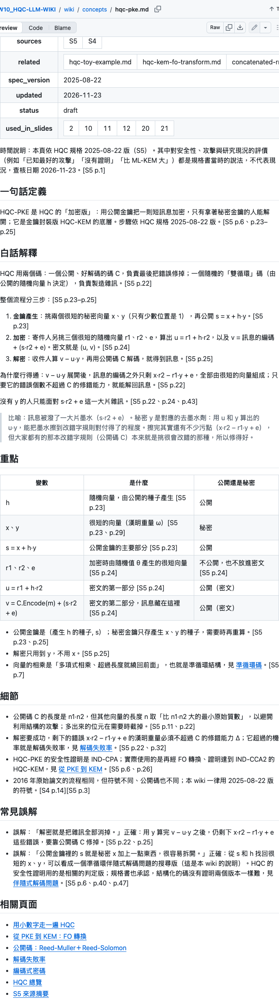
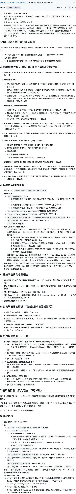
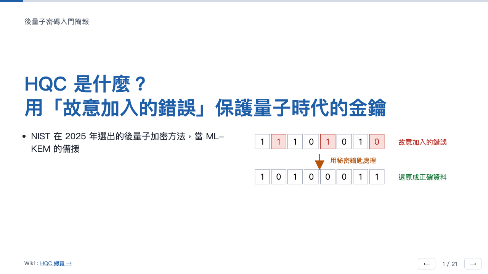
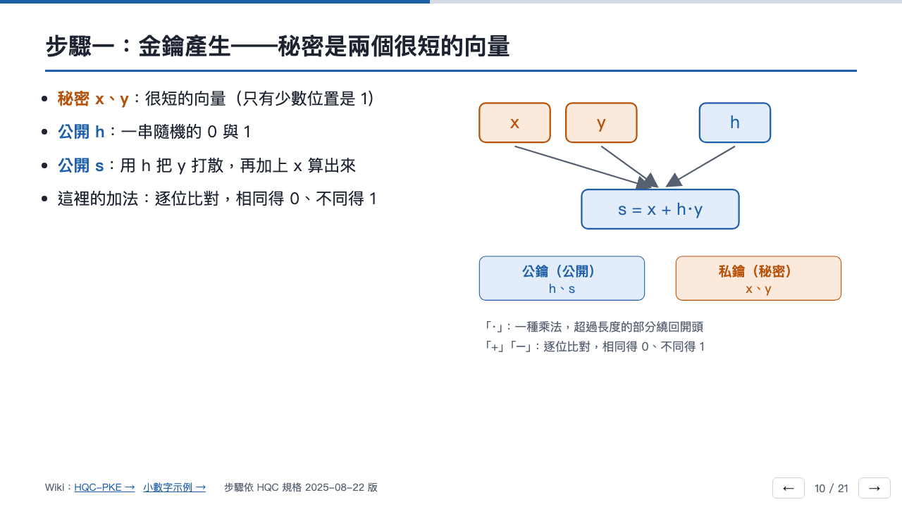
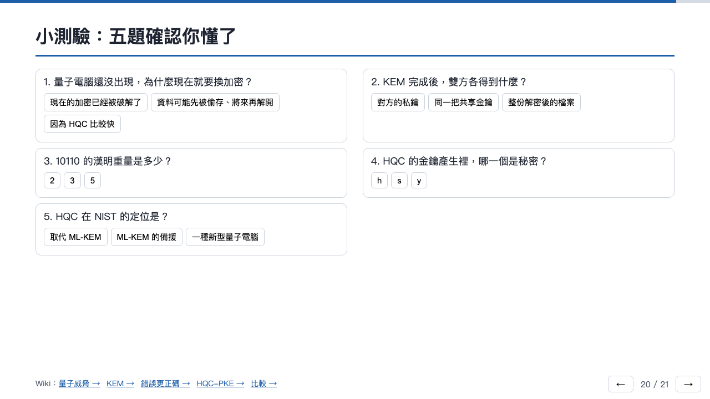
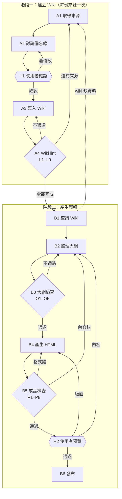
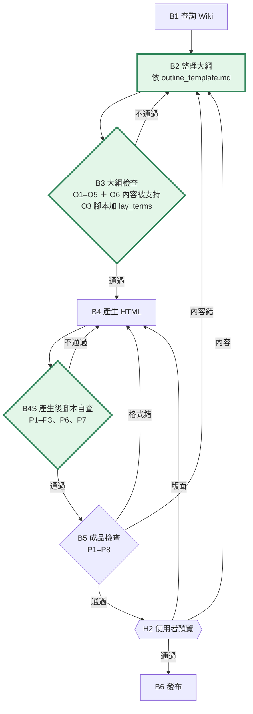

# <學校簡稱> <學號> <系級簡稱> <姓名> HQC後量子密碼教學

| 入口 | 連結 |
| --- | --- |
| 教學 HTML 簡報 | https://112306071.github.io/HW10_HQC-LLM-WIKI/slides/ |
| LLM Wiki | https://github.com/112306071/HW10_HQC-LLM-WIKI/blob/main/wiki/index.md |
| GitHub repo | https://github.com/112306071/HW10_HQC-LLM-WIKI |

---

## 1. LLM Wiki 主題與簡介

**主題**：HQC 是什麼？用「故意加入的錯誤」保護量子時代的金鑰。

**簡介**：HQC 是 NIST 在 2025 年 3 月選出的第五個後量子加密演算法，用來當一般加密主力 ML-KEM 的備援。它建立在錯誤更正碼上：故意在密文裡加錯誤，只有握有秘密金鑰的人能把錯誤縮小到修得回來。

**讀者**：完全沒有背景的一般人。依 2026-11-19 的討論紀錄 01，讀者從「沒學過編碼理論的大學生」放寬成一般人。

**為什麼選這個主題**：
- 後量子密碼正在換代。
- HQC 的核心點子「故意加錯誤」很反直覺，適合拿來測試 wiki 能不能把專業內容講清楚。

**Wiki 規模**：

| 項目 | 數量 |
| --- | --- |
| 內容頁（總覽 1、概念 12、實體 1、比較 2、來源摘要 5） | 21 頁 |
| 輔助頁（index、log、glossary） | 3 頁 |
| 術語 | 33 個 |
| 討論紀錄 | 5 份 |
| log 紀錄 | 30 多筆 |

**來源（5 份）**：

| 代碼 | 來源 | 類型 |
| --- | --- | --- |
| S1 | NIST，〈What Is Post-Quantum Cryptography?〉（2026-02-27 更新版） | 官方科普 |
| S2 | NIST，〈NIST Selects HQC as Fifth Algorithm for Post-Quantum Encryption〉（2025-03-11） | 官方新聞稿 |
| S4 | Aguilar-Melchor 等，〈Efficient Encryption from Random Quasi-Cyclic Codes〉（arXiv，2016） | HQC 原始論文 |
| S5 | HQC 團隊，〈Hamming Quasi-Cyclic (HQC)〉規格書 2025-08-22 版 | 演算法規格 |
| S6 | NIST（Angela Robinson），〈FIPS 207: HQC-KEM〉第 6 屆 PQC 標準化會議簡報（2025-09） | 官方簡報 |

> S3、S7、S8 原本在候選清單中，依使用者 2026-11-20 的決定不 ingest（討論紀錄 02）。

---

## 2. LLM Wiki 連結與成果

**入口**：https://github.com/112306071/HW10_HQC-LLM-WIKI/blob/main/wiki/index.md

**目錄結構**：

```
raw/            原始來源（只新增不修改；S4、S5 PDF 因版權不放進公開 repo）
discussions/    每份來源一份「先討論、後生成」紀錄（第 7 節是使用者回覆原文）
wiki/
  index.md      全部頁面索引
  log.md        每次 ingest、lint、衝突、workflow 修改的紀錄（只往後加）
  glossary.md   33 個術語，每個一句白話
  overview/     HQC 總覽
  concepts/     12 頁概念：量子威脅、KEM、錯誤更正碼、HQC-PKE、小數字示例……
  entities/     FIPS 207（HQC 的標準化進度）
  comparisons/  HQC vs ML-KEM、HQC 參數組
  sources/      5 份來源摘要
```

**寫作規則**（見 [CLAUDE.md](https://github.com/112306071/HW10_HQC-LLM-WIKI/blob/main/CLAUDE.md)）：
- 每個事實句結尾都附來源標記，例如 `[S5 p.29]`。
- 數字標明規格版本。
- 時效說法標查核日期。
- 來源衝突時兩邊都保留，並寫進 log。

**概念頁範例**：[HQC-PKE：金鑰產生、加密、解密](https://github.com/112306071/HW10_HQC-LLM-WIKI/blob/main/wiki/concepts/hqc-pke.md)



**先討論、後生成**：每份來源 ingest 前，AI 先寫討論備忘錄，提出 2–3 個問題。我回覆並確認後，AI 才寫入 wiki。

| 來源 | 我的回覆（原文） | 因討論而改變的地方 |
| --- | --- | --- |
| S1 | 見 [01](https://github.com/112306071/HW10_HQC-LLM-WIKI/blob/main/discussions/01-S1-nist-pqc-explainer.md) | 讀者改為「完全沒有背景的一般人」 |
| S2 | 見 [02](https://github.com/112306071/HW10_HQC-LLM-WIKI/blob/main/discussions/02-S2-nist-news-hqc.md) | 範圍改為聚焦 HQC 技術、來源刪到 5 份、簡報改 21 張 |
| S4 | 見 [03](https://github.com/112306071/HW10_HQC-LLM-WIKI/blob/main/discussions/03-S4-aguilar-melchor-qc-codes.md) | 第 7 張標題改寫：HQC 不是「藏結構」，而是「秘密金鑰能把錯誤縮小」 |
| S5 | 見 [04](https://github.com/112306071/HW10_HQC-LLM-WIKI/blob/main/discussions/04-S5-hqc-spec-2025-08-22.md) | 新增腳本計算的小數字示例；第 17 張只放 HQC-1 數字 |
| S6 | 見 [05](https://github.com/112306071/HW10_HQC-LLM-WIKI/blob/main/discussions/05-S6-nist-fips207-robinson.md) | 我質疑 S6 對一般人有沒有幫助，於是縮小 S6 的使用範圍，簡報不點名其他候選演算法 |



**log.md 節錄**：

```
## [2026-11-23 00:57] conflict | HQC 大小數字：S6 與 S5 不同
- S6 p.4（NIST 2025-09 簡報）：等級 1 的 HQC 公鑰 2,249、密文 4,497 位元組。
- S5 p.29（HQC 規格 2025-08-22 版）：HQC-1 公鑰 2,241、密文 4,433 位元組。
- 採用 S5。理由：CLAUDE.md 規定以 2025-08-22 版為準；S6 列為「考慮中」的修改 S5 都已採用……
```

---

## 3. 教學 HTML 簡報

**連結**：https://112306071.github.io/HW10_HQC-LLM-WIKI/slides/

**操作方式**：
- ← → 或空白鍵換頁，網址 `#7` 直接跳到第 7 張。
- 按 N 顯示講者備註。
- 手機上自動改成直式捲動。

**技術規格**：單一 HTML 檔，不載入任何外部資源。

| 封面 | 演算法流程（步驟一：金鑰產生） | 小測驗 |
| --- | --- | --- |
|  |  |  |

**教學結構**（21 張）：

| 段落 | 投影片 | 內容 |
| --- | --- | --- |
| 開場 | 1–2 | 封面、學習目標 |
| 動機 | 3–4 | 量子威脅與「先收集、後解密」、HQC 在 NIST 的位置（點到為止） |
| 基礎 | 5–9 | KEM、錯誤更正碼（腳本算的例子）、核心點子、McEliece vs HQC、準循環 |
| 運作 | 10–16 | 金鑰產生、加密、解密、小數字示例（腳本計算）、公開碼、FO 轉換、解碼失敗率 |
| 現況 | 17–18 | HQC vs ML-KEM、NIST 為什麼選 HQC 與標準化進度 |
| 驗收 | 19–21 | 四個常見誤解、5 題互動小測驗、總結與延伸閱讀 |

**Wiki ↔ 簡報對應**：
- 每張 `<section>` 都有 `data-wiki` 屬性，頁尾可以點到對應的 wiki 頁。
- 檢查腳本會驗證三件事：
  - P2：對應頁存在，且和大綱一致。
  - P3：投影片上的每個數字都出現在對應頁裡。
  - P4：每句話都被對應頁支持（語意檢查）。
- 反向對應寫在各 wiki 頁 frontmatter 的 `used_in_slides`。
- 全表見 [reports/slide_wiki_map.md](https://github.com/112306071/HW10_HQC-LLM-WIKI/blob/main/reports/slide_wiki_map.md)，以下是節錄：

| # | 投影片 | wiki 頁 | 來源 |
| --- | --- | --- | --- |
| 5 | KEM：在公開網路上安全地交換一把鑰匙 | concepts/kem.md | S2, S5 |
| 10 | 步驟一：金鑰產生 | concepts/hqc-pke.md、concepts/hqc-toy-example.md | S5, S4 |
| 13 | 用小數字走一遍 HQC | concepts/hqc-toy-example.md | S5 |
| 17 | HQC vs ML-KEM | comparisons/hqc-vs-ml-kem.md、comparisons/hqc-parameter-sets.md | S2, S5, S6 |
| 18 | NIST 選 HQC 當備援 | overview/hqc-overview.md、entities/fips-207.md | S2, S4, S5, S6 |

---

## 4. Loop / Graph 設計

**主流程**：取得資料 → 討論 → 寫入 Wiki → 檢查 Wiki → 查詢 Wiki → 整理大綱 → 檢查大綱 → 產生簡報 → 檢查簡報 → 人工預覽 → 發布。

- 機器可讀定義：[workflow/graph.yaml](https://github.com/112306071/HW10_HQC-LLM-WIKI/blob/main/workflow/graph.yaml)
- 每執行完一個節點，就用 `scripts/trace.py` 寫一筆紀錄。

**v1 流程圖**（[workflow/v1/graph.md](https://github.com/112306071/HW10_HQC-LLM-WIKI/blob/main/workflow/v1/graph.md)）：



**節點表（精簡）**：

| 節點 | 做什麼 | 執行者 |
| --- | --- | --- |
| A1 取得來源 | 下載、登記到 raw/sources.yaml | AI |
| A2 討論備忘錄 | 列重點、衝突、2–3 個問題 | AI |
| H1 確認【人工】 | 讀備忘錄、回答問題、回覆「確認」 | 我 |
| A3 寫入 Wiki | 依最終決定寫頁面，更新 index、log、glossary | AI |
| A3S 寫入後自查（v1.1） | lint 腳本 dry-run，不寫檢查紀錄 | 腳本 |
| A4 Wiki lint | L1–L9：結構、來源、連結、版本與時效、跨頁一致、先討論後生成 | 腳本＋獨立子代理 |
| B1 查詢 Wiki | 回答 21 張投影片各自的問題，附 wiki 頁與章節 | AI |
| B2 整理大綱 | 排成教學順序，每個重點標註 `[wiki: 頁#章節]` | AI |
| B3 大綱檢查 | O1 覆蓋、O2 標註存在、O3 術語先定義、O4 教學結構、O5 份量；v2 加 O6 | 腳本＋獨立子代理 |
| B4 產生 HTML | 單一檔案、內嵌 SVG | AI |
| B4S 產生後自查（v2） | 檢查腳本 dry-run（P1–P3、P6、P7） | 腳本 |
| B5 成品檢查 | P1 獨立檔、P2 對應、P3 數字、P4 內容被支持、P5 版本、P6 渲染、P7 導覽、P8 初學者評分 | 腳本＋playwright＋獨立子代理 |
| H2 預覽【人工】 | 用瀏覽器翻一遍 | 我 |
| B6 發布 | 複製到 slides/、產生對應表、push 到 GitHub Pages | AI＋腳本 |

### 哪些步驟會重複執行？

1. **Ingest 迴圈 A1→A4**：每份來源跑一次，共 5 次。
2. **討論迴圈 A2↔H1**：我要求修改就再來一輪（S2、S6 各兩輪）。
3. **Wiki 修正迴圈 A3↔A4**：lint 不過就修，最多 3 次。
4. **大綱迴圈 B2↔B3**：大綱不合格就重寫。
5. **生成迴圈 B4↔B5**：版面問題只重做 HTML。
6. **內容退回 B5→B2、H2→B2**：事實或教學問題回到大綱。
7. **補資料 B1→A1**：wiki 缺資料時回到階段一，一樣要過討論關卡。這次執行沒有觸發。

### 哪些地方需要檢查或重新生成？

| 檢查點 | 檢查什麼 | 方式 | 不通過時重新生成什麼 |
| --- | --- | --- | --- |
| H1 | 重點選得對不對、深度合不合適 | 人工 | 討論備忘錄 |
| A3S／A4 | 結構、來源標記、版本、時效、跨頁一致 | 腳本＋語意 | 出問題的 wiki 頁 |
| B3 | 覆蓋、標註、術語順序、教學結構、份量、（v2）內容被支持 | 腳本＋語意 | 大綱 |
| B4S／B5 | 對應、數字、內容被支持、版本、渲染、導覽、初學者看得懂 | 腳本＋截圖＋語意 | HTML（格式）或大綱（內容） |
| H2 | 整體好不好懂 | 人工 | 大綱或 HTML |

### 為什麼這樣設計？

1. **分兩個階段**：wiki 是會累積的知識，簡報是一次性的產物。查證放在 ingest，做簡報時只查 wiki，不重讀原文。
2. **人工關卡放在入口與出口**：錯的知識一旦進了 wiki，會被每張投影片引用，所以在入口（H1）擋；發布前（H2）再確認一次整體效果。
3. **先檢查大綱、再產生 HTML**：改大綱比改 HTML 便宜。
4. **失敗分流**：格式錯只重做 HTML，內容錯回大綱，缺資料才回 ingest，避免每次從頭來。
5. **重試上限**：每個檢查點最多 3 次，超過就交給我決定，避免無限迴圈。
6. **腳本與語意檢查並用**：
   - 腳本負責能明確判斷的事：連結、來源代碼、數字有沒有出現在 wiki。
   - 獨立子代理負責「有沒有被來源支持」「一般人看不看得懂」。子代理看不到生成時的對話，所以不會替自己的作品打分。
7. **每個節點都寫 trace**：反思「哪個節點最常出錯」要靠數據，不靠印象。

**v2 流程圖**（[workflow/graph.md](https://github.com/112306071/HW10_HQC-LLM-WIKI/blob/main/workflow/graph.md)，綠框是 v2 改的地方）：



> 版本演進：
> - v1 → v1.1（ingest 中途）：加 A3S，L7 詞表擴充。
> - v1.1 → v2（run-001 之後）：上圖的三處，以及上限規則。
>
> 理由見 [workflow/CHANGELOG.md](https://github.com/112306071/HW10_HQC-LLM-WIKI/blob/main/workflow/CHANGELOG.md)。

---

## 5. 實際執行與檢查紀錄

所有紀錄都由腳本寫入，只往後加：
- `runs/<run>/trace.jsonl`：每個節點一行。
- `runs/<run>/checks/*.json`：每次檢查一份。
- `runs/<run>/semantic/*.json`：子代理的語意判定。

彙整表由 `scripts/summarize_runs.py` 產生：[reports/run_summary.md](https://github.com/112306071/HW10_HQC-LLM-WIKI/blob/main/reports/run_summary.md)。

| 紀錄 | 內容 | 位置 |
| --- | --- | --- |
| ingest | 5 份來源 × A1–A4（含討論輪與 lint 重試），54 步 | [runs/ingest/](https://github.com/112306071/HW10_HQC-LLM-WIKI/tree/main/runs/ingest) |
| run-001-v1 | 用 v1.1 從 B1 跑到 B6，19 步 | [runs/run-001-v1/](https://github.com/112306071/HW10_HQC-LLM-WIKI/tree/main/runs/run-001-v1) |
| run-002-v2 | 用 v2、同一份問題清單從 B1 跑到 B6，{R2_STEPS} 步 | [runs/run-002-v2/](https://github.com/112306071/HW10_HQC-LLM-WIKI/tree/main/runs/run-002-v2) |

**各節點執行與失敗次數**（節錄自 run_summary.md）：

| 階段 | 節點 | 執行 | 失敗 | 最常失敗的檢查 |
| --- | --- | --- | --- | --- |
| ingest | A4 Wiki lint | 14 | 7（另有 2 次達上限 ESCALATED） | L7 語意（版本與時效） |
| ingest | A3S 寫入後自查 | 9 | 2 | L2 缺來源標記、L1 YAML |
| run-001 | B3 大綱檢查 | 5 | 3 | O3 語意（術語先定義） |
| run-001 | B5 成品檢查 | 3 | 2 | P4 語意（內容被支持）、P6 版面 |
| run-002 | B3 大綱檢查 | {R2_B3_RUNS} | {R2_B3_FAILS} | O6 語意（內容被支持） |
| run-002 | B4S 產生後自查 | {R2_B4S_RUNS} | 0 | — |
| run-002 | B5 成品檢查 | {R2_B5_RUNS} | 0 | — |


### 代表性案例

**案例 1：A4／L7 語意（ingest S2）**
- **錯在哪**：overview/hqc-overview.md「重點」寫「ML-KEM 仍是一般加密的推薦選擇」，沒有標出這是 S2 在 2025-03 的說法，也沒有查核日期。讀者會以為這是現況。
- **退回**：A3。
- **修改後**：「依 S2（2025-03）的說法，ML-KEM 仍是一般加密的推薦選擇（查核日期 2026-11-19）。」
- **後續**：S2 連續 3 次都卡在同類錯誤，達上限後經我同意續修，第 5 次通過。這直接促成 v1.1：把「主力、備援、仍是」等詞加進腳本，並新增 A3S 自查。
- 紀錄：[runs/ingest/checks/](https://github.com/112306071/HW10_HQC-LLM-WIKI/tree/main/runs/ingest/checks)

**案例 2：B3／O3 語意（run-001 大綱）**
- **錯在哪**：outline-v1 第 8 張「秘密改成一對『很短』的向量：大多是 0」，「向量」第一次出現卻沒有定義。同一輪共抓到 11 個詞，包括密文、位元、公鑰、NIST、+·− 符號。
- **退回**：B2。
- **修改過程**：
  - v2 補上定義，但「很短」的特殊意思還是沒寫上畫面，又被抓到。
  - v3 改成「秘密是兩個『很短』的向量：一長串 0 與 1，只少數是 1」，第 3 次通過。
- 紀錄：[B3-outline-v1-a1.json](https://github.com/112306071/HW10_HQC-LLM-WIKI/blob/main/runs/run-001-v1/checks/B3-outline-v1-a1.json)

**案例 3：B5／P4 語意（run-001 成品）**
- **錯在哪**：slides-v1 有 5 句說得比 wiki 肯定。例如第 17 張「比 ML-KEM 大、吃資源，但運作乾淨、安全」：wiki 原文是「審查者認為……運作乾淨、安全」，簡報把評價寫成了事實。第 3 張標題也把 wiki 的「可能」寫成「會」。
- **退回**：B2（內容錯）。
- **修改後**：「審查者認為：雖然較大、吃資源，但運作乾淨、安全」。
- **後續**：之後又因 P6 版面溢出退回一次 B4，第 3 次通過。
- **問題在哪**：這 5 句在大綱裡就已經存在，v1 卻要等 HTML 做完才查得到。這是 v2 新增 O6 的直接原因。
- 紀錄：[B5-slides-v1-a1.json](https://github.com/112306071/HW10_HQC-LLM-WIKI/blob/main/runs/run-001-v1/checks/B5-slides-v1-a1.json)

**案例 4：B3／O6 語意（run-002，v2 新檢查）**
- **錯在哪**：outline-v1 第 7 張的圖示寫「用去墨水劑擦到只剩幾個污點」。但 wiki 明說擦完後錯誤「其實不少」，判為 UNSUPPORTED。
- **退回**：B2。
- **修改後**：「剩下的污點其實不算少，但錯誤更正碼很會改錯」，第 2 次通過。
- **發現**：run-001 已發布的第 7 張也有同一句，當時 B5 三次都沒抓到。大綱階段逐句對照，比成品階段整份看更細。
- 紀錄：[B3-outline-v1-a1.json（run-002）](https://github.com/112306071/HW10_HQC-LLM-WIKI/blob/main/runs/run-002-v2/checks/B3-outline-v1-a1.json)

**執行中的流程問題**（照實記在 [runs/run-001-v1/issues.md](https://github.com/112306071/HW10_HQC-LLM-WIKI/blob/main/runs/run-001-v1/issues.md)）：
1. **超過步數上限沒有停**：run-001 階段二共 19 步，超過 v1.1 規定的上限 15 步，但當時沒有停下來交給我。
2. **一筆 trace 早寫了**：有一筆 trace 比實際修改早約 1 分鐘寫入。
3. **重試次數算法沒寫清楚**：B3 重新進入時怎麼算次數，規格沒寫。

三者都已寫進 v2 的規則。

---

## 6. 反思

> **初稿**：由 AI 依紀錄撰寫，數字取自 reports/run_summary.md。繳交前請改成你自己的話。

### 哪一個節點最常出錯？

{REFLECTION_1}

### 你發現問題後，把檢查往前移到了哪一個步驟？

{REFLECTION_2}

### 你有沒有因此修改 workflow／graph？為什麼？

{REFLECTION_3}

### 限制

{REFLECTION_4}

---

## 附錄：如何重現

```bash
python3 -m venv .venv && .venv/bin/pip install pyyaml beautifulsoup4 playwright
.venv/bin/python -m playwright install chromium

# 檢查腳本自我測試（用 tests/fixtures 裡刻意放錯的樣本）
.venv/bin/python scripts/lint_wiki.py --selftest
.venv/bin/python scripts/check_outline.py --selftest
.venv/bin/python scripts/check_slides.py --selftest

# 全 wiki lint（只看結果、不寫紀錄）
.venv/bin/python scripts/lint_wiki.py --target all --dry-run

# 教學示例（第 6、13 張的數字）
.venv/bin/python scripts/examples.py --toy

# 彙整所有執行紀錄 → reports/run_summary.md、reports/node_failures.svg
.venv/bin/python scripts/summarize_runs.py
```

**主要檔案**：

| 類別 | 檔案 |
| --- | --- |
| 規格與規則 | SPEC.md（規格書）、CLAUDE.md（wiki 規則） |
| 流程定義 | workflow/graph.yaml、graph.md、CHANGELOG.md、v1/、v1.1/、v2/、outline_template.md、lay_terms.yaml |
| 腳本 | scripts/trace.py、lint_wiki.py、check_outline.py、check_slides.py、examples.py、summarize_runs.py、publish.py |
| 執行紀錄 | runs/ingest、runs/run-001-v1、runs/run-002-v2 |
| 報告 | reports/run_summary.md、node_failures.svg、slide_wiki_map.md |
