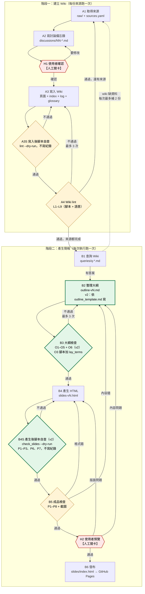

# Workflow v2 流程圖

14 個節點：8 個動作、5 個自動檢查點（菱形）、2 個人工關卡（紅框）。

- 綠框是 v2（2026-11-23）依 run-001 數據新增或修改的地方，原因見 [CHANGELOG.md](CHANGELOG.md)。
- 舊版圖：[v1.1](v1.1/graph.md)、[v1](v1/graph.md)。
- 機器可讀定義見 [graph.yaml](graph.yaml)，規格見 [SPEC.md §7](../SPEC.md#7-loop--graph-設計)。

## 重試上限

| 檢查點 | 退回 | 上限 | 超過時 |
| --- | --- | --- | --- |
| A3S、B4S | A3、B4 | 不設上限（作者自查，不寫檢查紀錄；每次執行都寫 trace） | — |
| A4 | A3 | 3 次 | `ESCALATED`，交給使用者決定 |
| B3 | B2 | 3 次 | 同上 |
| B5 | B4（格式）或 B2（內容） | 兩種合計 3 次 | 同上 |
| B1 → A1 | 補來源 | 每次執行 2 份 | 同上 |
| 階段二總步數 | — | 25 步（v2 由 15 調整） | 同上 |

v2 寫明次數的算法：計算的是「同一輪的連續失敗」。通過之後如果再次進入同一個檢查點，次數從 1 重新算。例如 B5 退回 B2 之後重新過 B3，就是新的一輪。
